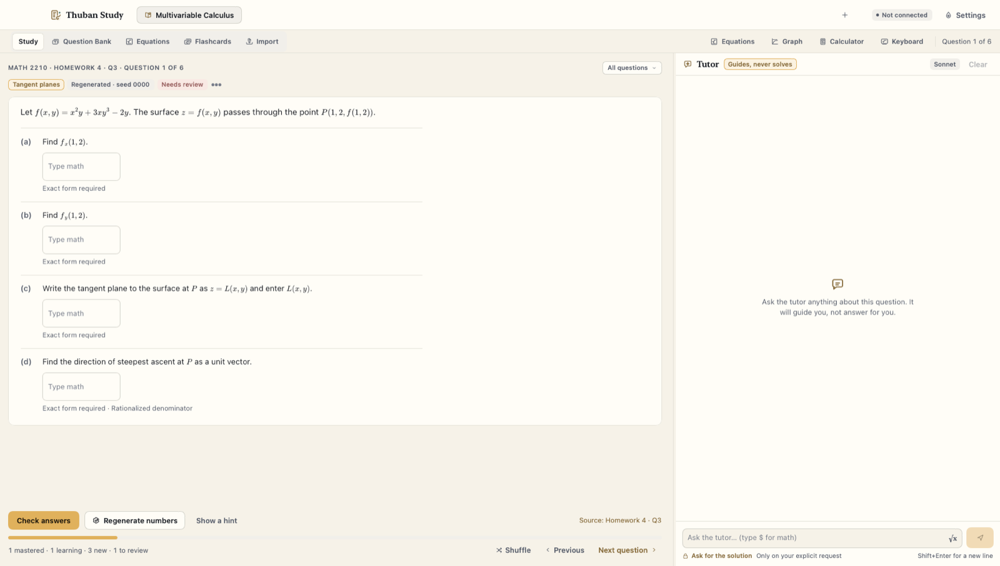
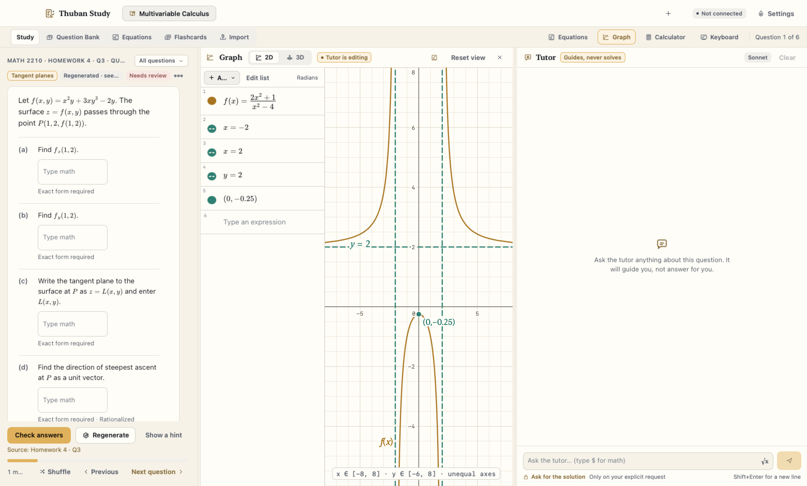
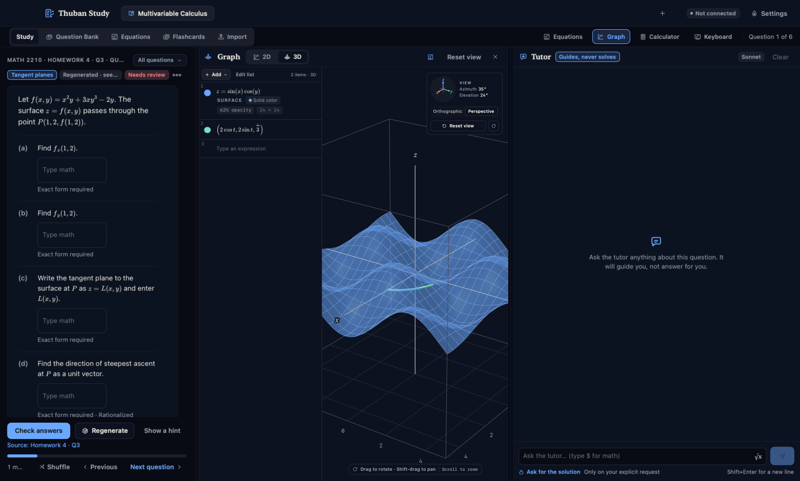
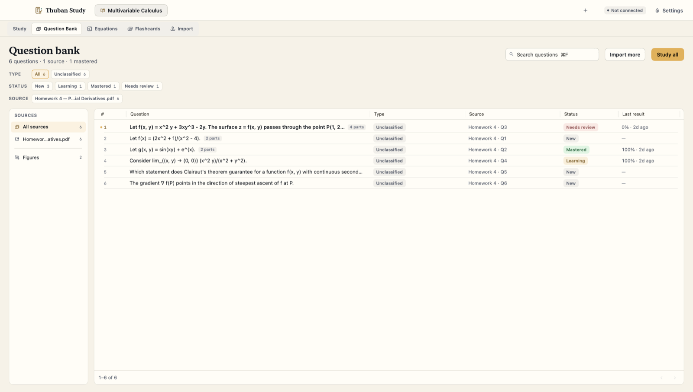
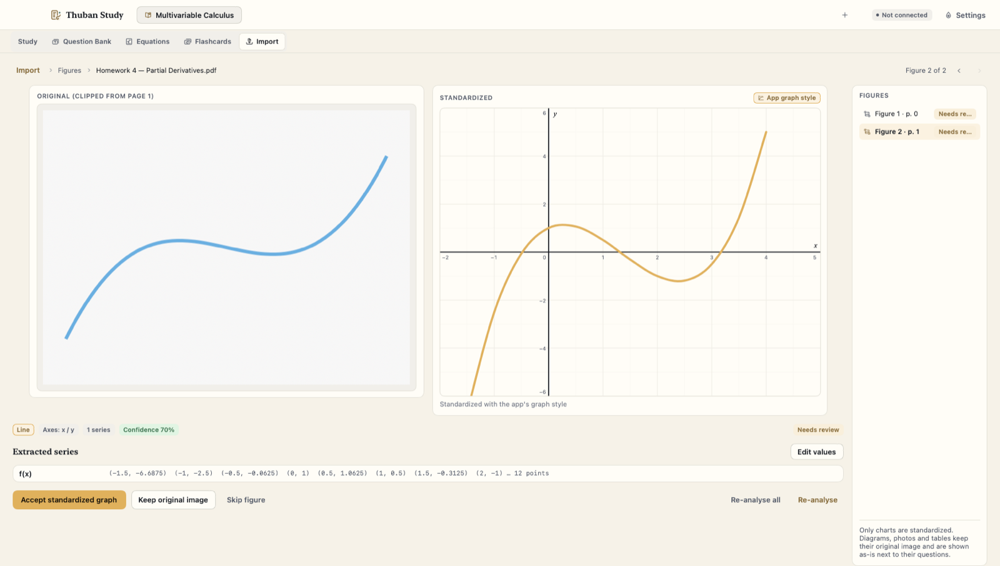
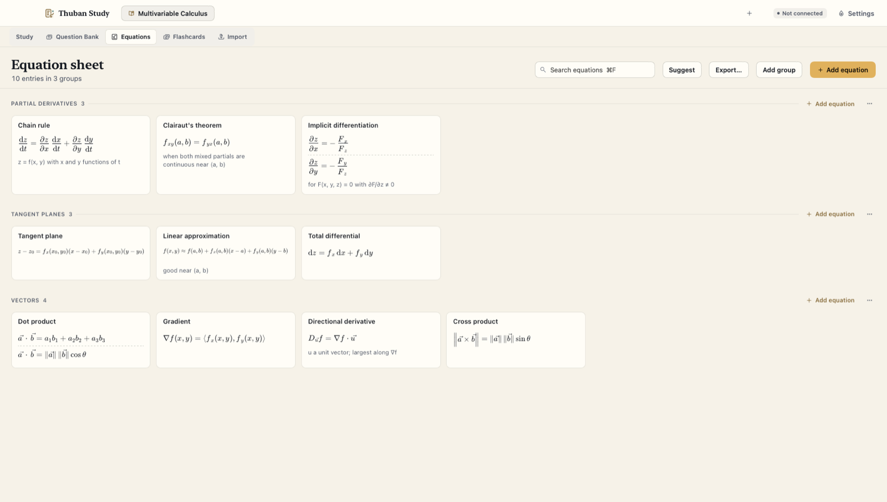
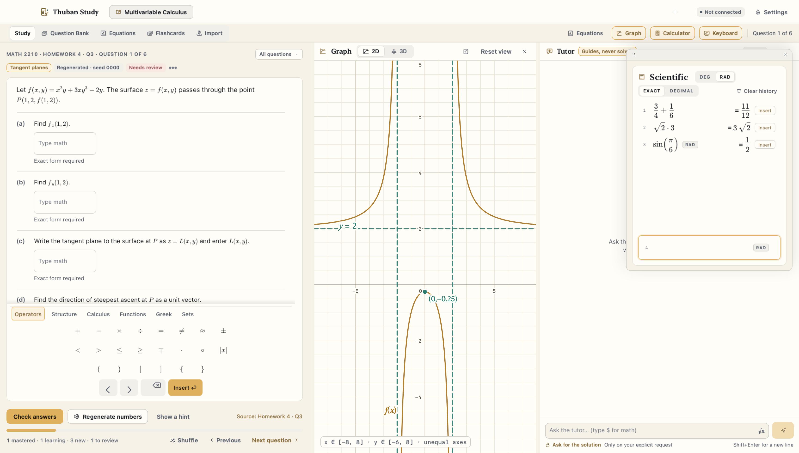

# Thuban Study

A native macOS study app for STEM classes: turn homework and exam PDFs into a question bank, then work problems
next to a Claude tutor that guides you instead of giving you the answer.



## Why

Course platforms give you each homework set once, then lock it. Studying for an exam means going back through
old PDFs and redoing problems you have already seen the answers to. Thuban Study takes the documents you already
have, pulls the questions out into a bank for each class, and lets you work them again in a WebAssign-style
form. Math questions come back with fresh numbers, and the tutor is told to coach you rather than solve the
problem for you.

## Features

**Question bank from your own documents**
- Import PDF, Word, PowerPoint, Excel, CSV, HTML, MHTML, Markdown, plain text and images (with on-device OCR).
- A Claude import agent splits each document into questions with lettered parts, answer kinds and problem-type
  tags. It uses Sonnet by default and can escalate to Opus for dense material, if you allow it.
- You can filter the bank by type, status (New, Learning, Mastered, Needs review) and source document.

**Working problems**
- MathLive answer boxes with a math keyboard. Answers are graded locally by a computer-algebra engine, so any
  algebraically equivalent answer is accepted unless the question sets conditions (exact form, rationalized
  denominator, and so on).
- Template questions can be regenerated with new numbers from a seeded generator.
- Every question tracks progress, so you can see what is new, what you are still learning and what you have
  mastered.

**AI tutor**
- A chat panel next to the question, with three styles: Socratic, direct hints, or exam mode (it stays quiet
  until you check your answers).
- The tutor can read the work you have entered and can open, edit and re-frame the graph. You can turn graph
  editing off.
- It only gives a full solution if you ask for one explicitly.

**Graphing and calculator**
- An offline 2D and 3D grapher (the Thuban Graph engine) and a scientific calculator with exact and decimal
  modes, both one toggle away from the question.

**Figures**
- Charts clipped from imported documents are read back into data (function curves, direction fields, line
  series), checked against the question text, and redrawn in the app's graph style. You review each one and
  choose to accept the redraw, keep the original image or skip the figure. Diagrams and photos keep their
  original image.

**Equation sheets and flashcards**
- One equation sheet per class, with groups, typeset math, notes, search and export. After an import, Claude
  suggests general equations the new questions need, and you approve or deny each one.
- A flashcard deck per class, generated from notes or documents and reviewed by you before any card is added. It
  uses spaced repetition with reviews at 1, 3, 7, 14 and then at most 21 days.

**Look and feel**
- Light and dark color schemes. The scheme is shared with the other Thuban apps.

## Screenshots

<table>
  <tr>
    <td></td>
    <td></td>
  </tr>
  <tr>
    <td align="center"><sub>2D graph next to the question; the tutor can edit it</sub></td>
    <td align="center"><sub>3D surfaces and space curves, dark scheme</sub></td>
  </tr>
  <tr>
    <td></td>
    <td></td>
  </tr>
  <tr>
    <td align="center"><sub>Question bank built from an imported PDF</sub></td>
    <td align="center"><sub>Figure review: the clipped original and its redraw</sub></td>
  </tr>
  <tr>
    <td></td>
    <td></td>
  </tr>
  <tr>
    <td align="center"><sub>Per-class equation sheet</sub></td>
    <td align="center"><sub>Scientific calculator with exact answers</sub></td>
  </tr>
</table>

The screenshots come from the app's offline smoke test, which uses a seeded demo class.

## Built with

- **Swift and SwiftUI** on macOS 15, with the Xcode project generated by [XcodeGen](https://github.com/yonaskolb/XcodeGen).
- **[GRDB.swift](https://github.com/groue/GRDB.swift)** (SQLite), **[ZIPFoundation](https://github.com/weichsel/ZIPFoundation)**,
  **[SwiftSoup](https://github.com/scinfu/SwiftSoup)** and **[CoreXLSX](https://github.com/CoreOffice/CoreXLSX)** for
  storage and document parsing; PDFKit and Vision for PDFs and OCR.
- **Claude API** (Messages API with tool use and streaming) for the import, tutor, figure, equation and flashcard
  agents. Models: `claude-sonnet-5` (default), `claude-opus-5` (escalation) and `claude-haiku-4-5-20251001`.
- **Thuban Graph** (`ThubanGraphKit`) for the 2D/3D grapher and calculator.
- Vendored web libraries, each under its own license:
  - [MathLive](https://github.com/arnog/mathlive) 0.110.0 for math input and rendering (MIT, see
    `ThubanStudy/Resources/web/vendor/mathlive/LICENSE.txt`)
  - [Cortex Compute Engine](https://github.com/cortex-js/compute-engine) 0.128.13 for grading and equivalence
    checks, run in JavaScriptCore (MIT)
  - [marked](https://github.com/markedjs/marked) 15.0.12 (MIT) and [DOMPurify](https://github.com/cure53/DOMPurify)
    3.4.15 (Apache-2.0 / MPL-2.0) for the tutor transcript

## How it was built

The owner designed and directed Thuban Study. The code was written with Claude Code (AI-assisted).

## Architecture

- **`Packages/ThubanCore`** is the engine and has no UI. It holds the domain models, the GRDB store, the theme
  resolver, the math engine (Compute Engine in JavaScriptCore for grading, equivalence, answer conditions and
  template instantiation), the Claude client and agents, and the document parsers.
- **`Packages/StudyGraph`** connects the app to the Thuban Graph engine. It contains the graph pane, the
  calculator, the tutor's graph tools and graph persistence.
- **`ThubanStudy/`** is the SwiftUI app: the shell with class tabs, Study, Question bank, Equations, Flashcards,
  Import with figure review, and Settings.
- **`ThubanStudy/Resources/web`** has small WKWebView pages for anything that needs MathLive: the question form and
  math keyboard, the tutor transcript, the equation sheet and the flashcard deck. They talk to Swift through a
  message bridge.
- **The agents** (`ThubanCore/AI/Agents`) are tool-using Claude loops. The import agent writes question drafts,
  the tutor calls eight app tools (graph, calculator, read the student's work), and the figure pipeline fits,
  verifies and reconciles chart data before you review it.

[`ARCHITECTURE.md`](ARCHITECTURE.md) has the full contract. `docs/` holds the design brief, color values, icon set
and integration notes.

## Getting started

**Requirements**

- macOS 15 or newer and Xcode 26. The project uses the Swift 6 toolchain in Swift 5 language mode.
- A local checkout of [Thuban Graph](https://github.com/ChancellorVerdery/thuban-graph), which provides `ThubanGraphKit`.
- A Claude account or an Anthropic API key, for the AI features. Without one, the bank, grading, graphing,
  calculator, equation sheets and flashcard review still work.

**Link Thuban Graph.** The build gets the graph engine through a symlink at `Vendor/ThubanGraph`, which is
gitignored. `scripts/link-graph.sh` creates it. Every other script runs it first, so in practice you only need to
tell it where your checkout is:

```sh
git clone https://github.com/ChancellorVerdery/thuban-graph.git "../Thuban Graph"
export THUBAN_GRAPH_ROOT="$PWD/../Thuban Graph"   # default: ~/Desktop/Claude/Thuban Graph
```

**Build, test, run**

```sh
./scripts/build.sh                 # Debug build into .build/DerivedData (ad-hoc signed)
open ".build/DerivedData/Build/Products/Debug/Thuban Study.app"
./scripts/test.sh                  # ThubanCore tests, then StudyGraph tests
./scripts/smoke.sh                 # launch with seeded demo data and screenshot every screen
OFFLINE=1 ./scripts/smoke.sh       # the same with the network denied
./scripts/launch-check.sh          # launch the Debug build, confirm it stays up, quit it
./scripts/install.sh               # Release build copied to /Applications
```

You can also open `ThubanStudy.xcodeproj` in Xcode and run the `ThubanStudy` scheme. The project file is generated
from `project.yml`, so run `xcodegen` again after adding source files.

**Connect Claude.** Open Settings › Claude account. There are two ways to connect:

- **Sign in with a Claude account.** This is a browser OAuth flow (authorization code with PKCE): you paste the
  code the callback page shows, and the app refreshes the token itself after that.
- **Paste an Anthropic API key.**

## Privacy

- **Everything stays on your Mac.** The SQLite database, imported documents, clipped figures and graphs all live
  under `~/Library/Application Support/Thuban Study`. Set `THUBAN_HOME` to move it. Settings › Data & storage
  exports everything as a zip.
- **Credentials** (OAuth tokens or the API key) are kept in `credentials.json` in that folder with file mode
  `0600`. The file is left out of exports. The login Keychain is not used, because an ad-hoc-signed build changes
  its code identity on every rebuild, which would make macOS ask for Keychain access at every launch.
- **What goes to the Claude API, and only when you use an AI feature:**
  - Importing a document sends its extracted text and page images.
  - Figure review sends the clipped figures.
  - The tutor gets the current question, your messages and, through its tools, the answers you have entered.
  - Flashcard generation sends the notes or documents you pick.
  - Equation suggestions send the newly imported questions and the class's current equation sheet.
- Grading, graphing, the calculator and question regeneration run entirely offline. Nothing is sent anywhere else.

## The Thuban suite

Thuban Study is part of a set of macOS apps that share one color scheme:

- [Thuban Graph](https://github.com/ChancellorVerdery/thuban-graph): an offline 2D/3D graphing calculator (the engine
  inside Study)
- [Thuban Canvas](https://github.com/ChancellorVerdery/thuban-canvas): a native Canvas LMS client
- [Thuban Desk](https://github.com/ChancellorVerdery/thuban-desk): calendar and mail
- [Thuban Gym](https://github.com/ChancellorVerdery/thuban-gym): a workout tracker
- [Thuban Planner](https://github.com/ChancellorVerdery/thuban-planner): a degree planner

---

All rights reserved.
